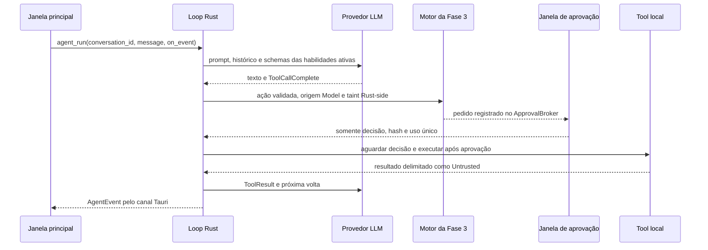

# Arquitetura

O Rust executa o loop de agente por `agent_run`; a tela de Conversas oferece o modo agente por
conversa, o botão Parar e os cartões persistentes de ações. Conversas novas iniciam com o modo
ligado quando a pasta/identidade, uma habilidade ativa e um provedor com tool calling elegível
estão disponíveis. As habilidades e decisões permanecem no registro e no motor Rust.

O catálogo de provedores em `src-tauri/resources/provider-catalog.json` alimenta os metadados do frontend e do Rust. O Rust valida host e caminho, acessa credenciais e implementa listagem documentada de modelos. As preferências guardam configurações por `providerId`; perfil e histórico usam SQLite local. Avatar é processado no Rust e servido como data URL apenas para a interface principal.

`src/ui/design-tokens.css` centraliza as cores, a tipografia, o espaçamento, os raios e as sombras da interface. `src/ui/DesignSystem.tsx` oferece componentes compartilhados para botões, cartões, avisos, campos, seletores, alternâncias, opções selecionáveis e cabeçalhos. A interface aplica esses padrões nas telas principais; a conferência visual em tamanhos e escalas de Windows continua manual.

## Loop de agente Rust

O motor valida nome e schema antes de chamar o registro. Risco e permissão são calculados em Rust;
chamadas parciais não chegam ao executor. Uma negação vira ToolResult e não autoriza tentar o mesmo
efeito por outra ferramenta. Repetição, duração, turnos, tokens, comunicações e tamanho do contexto
são limitados pelo motor. O roteador só troca de provedor em falhas transitórias antes de observar
saída. A tabela `agent_messages` registra tipo, habilidade, id de auditoria e hashes; argumentos e
resultados brutos não são persistidos.

`AgentEvent` é o contrato serializado do canal: `step`, `toolCall`, `actionCard`, `awaitingApproval`,
`toolResult`, `finalResponse`, `error` e `stopped`. Cartões guardam descrição, risco, decisão,
status e um resumo sem parâmetros ou resultados brutos. `agent_cancel(conversation_id)` cancela uma
execução; o kill switch para todas. `approval_respond` apenas resolve a decisão pendente; o loop
retoma a ação após receber o canal.

## Aplicativo

O frontend usa React + TypeScript + Vite. `src/core/` mantém regras sem dependência da apresentação; `src/ui/` contém o Hub e a janela única `pet`. Na abertura, o Tauri cria somente `main`; a janela `pet` é criada sob demanda e opera nos modos Ilha ou Livre. A janela de aprovação continua independente. Comandos Rust controlam posição, tamanho, visibilidade e prioridade; eventos conectam o chat à FSM do pet.

## Pet 2D

O pet padrão é o sprite CSS de `assets/pets/kenney-mini-characters/`, escolhido pelo usuário e
persistido na tabela `pet_preferences` do SQLite local. O catálogo `pets.json` é validado no
frontend e no Rust; nomes de arquivo aceitos são apenas nomes simples `.png`. Estados da FSM são
convertidos em animações CSS, que ficam estáticas quando a preferência do aplicativo ou do sistema
reduz movimento está ativa.

O componente `PetSprite` renderiza o PNG selecionado e animações CSS associadas aos estados da FSM. Ele é usado na Visão geral, no chat, na prévia do Assistente e nas janelas auxiliares. A preferência `reduzir animações` e `prefers-reduced-motion` mantêm o sprite estático. Three.js é usado somente pelo script de desenvolvimento `scripts/render-pets.mjs`; não é importado pelo frontend nem pelo runtime Tauri. Modelos proprietários não são necessários para compilar ou executar o aplicativo.

## Ilha, áudio e armazenamento

O SQLite também soma tokens de entrada e saída por provedor e dia UTC. A interface consulta os totais do dia e dos últimos sete dias; o limite diário é configurado pelo usuário e zero desativa o limite.

`src/core/island.ts` implementa transições e prioridades. `src/core/sounds.ts` carrega sons sob demanda, mantém cache, limita repetições, aplica volume e ignora arquivos ausentes ou inválidos. Preferências não secretas ficam no armazenamento local do WebView; chaves de API não são salvas. O histórico de conversas fica em SQLite na pasta de dados do aplicativo, acessado somente pelos comandos Rust da janela principal.

Conversas apresenta uma lista pesquisável com título, data e prévia; o SQLite armazena título,
mensagens, modo agente e cartões de ação. A tela permite selecionar, renomear e apagar uma conversa.
O painel da conversa mostra mensagens do usuário à direita e respostas à esquerda; o avatar das respostas usa
o ícone do aplicativo por padrão, com uma preferência para usar o mascote. As respostas usam um
renderizador Markdown que cria elementos React a partir de texto, sem interpretar HTML. Links só
aceitam `http` e `https`.

A janela `pet` usa transparência sem região Win32 e não ignora eventos do ponteiro. Os cantos transparentes continuam pertencendo à janela e podem receber cliques; arrasto, foco, DPI e monitores múltiplos exigem validação visual no Windows.

## Pasta e identidade do agente

`src-tauri/src/agent_home.rs` valida a pasta escolhida na primeira execução (sugestão: `%USERPROFILE%\OdeKrai`) e cria `ODEKRAI.md`, `memory/`, `workspace/`, `skills/` e `logs/`. O template está embutido no Rust; o repositório não contém o arquivo pessoal gerado. A última versão aprovada e seu SHA-256 ficam nos dados locais do aplicativo. Uma alteração externa suspende o prompt até revisão e aprovação.

O Rust compõe o prompt com regras fixas, preâmbulo local de data/hora/fuso/idioma, identidade aprovada, até 1.024 caracteres de `memory/estilo.md` e o modo efetivo lido do SQLite local. `agent_run` acrescenta apenas descrições de habilidades ativas. Anthropic recebe `system`, APIs Chat Completions recebem mensagem `system` e a Perplexity Agent API recebe `instructions`; provedores sem tool calling elegível são excluídos do loop. O chat textual existente continua disponível sem pasta configurada.

## Motor de permissões

`src-tauri/src/policy.rs` contém a política pura e tabelada de modo, risco, origem e localização no workspace. `src-tauri/src/security.rs` guarda o estado de segurança em SQLite, valida os parâmetros tipados de `SimulatedAction`, decide e registra auditoria antes da execução. Só as ações de arquivo dentro de `workspace/` têm efeito local; comunicação é apenas simulada e pagamento é sempre bloqueado.

Pedidos `AskUser` entram numa fila Rust limitada e abrem a janela Tauri `approval`. A capability `src-tauri/capabilities/approval.json` dá somente os eventos e o fechamento de janela necessários. A confirmação, expiração, hash dos parâmetros e uso único são verificados no Rust; a janela apenas resolve o canal, e o loop executa a ação aprovada. A janela principal configura modo/atalho e consulta a tela de atividade; não pode responder aprovações.

O plugin Tauri `global-shortcut` registra o atalho no processo nativo. O kill switch persiste a parada, cancela tokens dos streams, nega a fila e bloqueia novos envios a provedores. Retomar só funciona depois de gravar a entrada de auditoria. As decisões no WebView servem somente para exibição e entrada do usuário.

## Limites conhecidos

- Um ensaio anterior abriu o executável com o UDF WebView2 padrão. O erro `0x800700AA` também ocorreu em outra tentativa; a causa permanece inconclusiva. O plugin de instância única evita abrir uma segunda instância do aplicativo, mas seu efeito sobre esse erro precisa de teste nativo.
- A nitidez dos sprites, as animações, o recorte dos avatares e o hit-testing das janelas auxiliares precisam de validação visual no Windows.
- Escalas DPI, monitores adicionais, reconexão, fullscreen e hit-testing ainda precisam de validação manual.
- Nenhum áudio Kenney foi integrado.

## Inicialização do painel

Janelas auxiliares são construídas somente por caminhos assíncronos. A restauração do pet ocorre após as leituras iniciais, com limite de cinco segundos e sem condicionar a janela principal. Uma inicialização anterior incompleta ativa o modo seguro e mantém essas janelas desligadas nessa sessão. Falhas de inicialização e erros não tratados do frontend aparecem no banner **Diagnóstico** e são registrados em `app_data_dir/logs/diagnostic.log`, sem mensagens de conversa, segredos ou texto livre de erros.

Comandos nativos de leitura usados durante a abertura (pasta do agente, credenciais, perfil, permissões, mascote e histórico) são assíncronos no Tauri para não executar trabalho de disco ou do Gerenciador de Credenciais na thread principal da janela.
