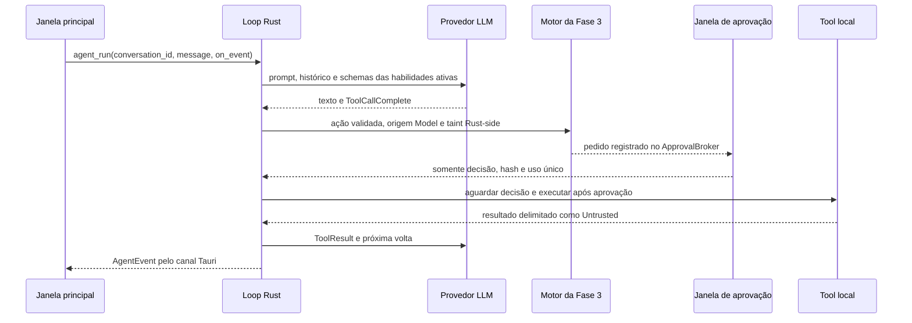

# Arquitetura

O Rust executa o loop de agente por `agent_run`; a tela de Conversas oferece o modo agente por
conversa, o botão Parar e os cartões persistentes de ações. Conversas novas iniciam com o modo
ligado quando a pasta/identidade, uma habilidade ativa e um provedor com tool calling elegível
estão disponíveis. As habilidades e decisões permanecem no registro e no motor Rust.

O catálogo de provedores em `src-tauri/resources/provider-catalog.json` alimenta os metadados do frontend e do Rust. O Rust valida host e caminho, acessa credenciais e implementa listagem documentada de modelos. As preferências guardam configurações por `providerId`; perfil e histórico usam SQLite local. Avatar é processado no Rust e servido como data URL apenas para a interface principal.

`src/ui/design-tokens.css` centraliza as cores, a tipografia, o espaçamento, os raios e as sombras da interface. `src/ui/DesignSystem.tsx` oferece componentes compartilhados para botões, cartões, avisos, campos, seletores, alternâncias, opções selecionáveis e cabeçalhos. A interface aplica esses padrões nas telas principais; a conferência visual em tamanhos e escalas de Windows continua manual.

## Loop de agente Rust

O motor valida nome e schema antes de chamar o registro. Risco e permissão são calculados em Rust;
chamadas parciais não chegam ao executor. Uma negação vira ToolResult e não autoriza tentar o mesmo
efeito por outra ferramenta. Repetição, duração, turnos, tokens, comunicações e tamanho do contexto
são limitados pelo motor. O roteador só troca de provedor em falhas transitórias antes de observar
saída. A tabela `agent_messages` registra tipo, habilidade, id de auditoria e hashes; argumentos e
resultados brutos não são persistidos.

`AgentEvent` é o contrato serializado do canal: `step`, `toolCall`, `actionCard`, `awaitingApproval`,
`toolResult`, `finalResponse`, `error` e `stopped`. Cartões guardam descrição, risco, decisão,
status e um resumo sem parâmetros ou resultados brutos. `agent_cancel(conversation_id)` cancela uma
execução; o kill switch para todas. `approval_respond` apenas resolve a decisão pendente; o loop
retoma a ação após receber o canal.

## Aplicativo

O frontend usa React + TypeScript + Vite. `src/core/` mantém regras sem dependência da apresentação; `src/ui/` contém o Hub e a janela única `pet`. Na abertura, o Tauri cria somente `main`; a janela `pet` é criada sob demanda e opera nos modos Ilha/Compacto ou Livre. O modo Compacto expande a janela existente, não cria outro WebView. A janela de aprovação continua independente. Comandos Rust controlam posição, tamanho, visibilidade e prioridade; eventos conectam o chat à FSM do pet.

O Início (`Overview`) combina o campo compartilhado `MessageComposer`, sugestões puras de `core/home`, checklist de configuração e retomada de conversas. O bloco de retomada compartilha a largura máxima do compositor e distribui conversas recentes em uma grade responsiva. Sugestões são inseridas como rascunho e nunca enviadas automaticamente. Ctrl+K abre `CommandPalette`; o gatilho de Atividade abre `ActivitySidePanel` somente quando solicitado. O modo Desempenho aplica uma preferência persistida ao `<html>` principal e sincroniza o mesmo estado para a janela do pet.

Com o painel lateral aberto e a habilidade `reminder.list` ativa, o comando assíncrono `get_upcoming_reminders` consulta no SQLite os próximos lembretes (máximo de 20, até 168 horas). Retorna apenas título truncado, horário local com fuso e status; notas nunca são expostas. O limite do painel é 24 horas. A lista não é consultada enquanto o painel está fechado; a contagem existente continua compartilhada com o contexto do Início.

## Pet 2D

O pet padrão é o sprite CSS de `assets/pets/kenney-mini-characters/`, escolhido pelo usuário e
persistido na tabela `pet_preferences` do SQLite local. O catálogo `pets.json` é validado no
frontend e no Rust; nomes de arquivo aceitos são apenas nomes simples `.png`. Estados da FSM são
convertidos em animações CSS, que ficam estáticas quando a preferência do aplicativo ou do sistema
reduz movimento está ativa.

O componente `PetSprite` renderiza o PNG selecionado e animações CSS associadas aos estados da FSM. Ele é usado no Início, no chat, nos estados vazios, na prévia do Assistente e nas janelas auxiliares. A preferência `reduzir animações`, `prefers-reduced-motion` e o modo Desempenho podem manter o sprite estático. Three.js é usado somente pelo script de desenvolvimento `scripts/render-pets.mjs`; não é importado pelo frontend nem pelo runtime Tauri. Modelos proprietários não são necessários para compilar ou executar o aplicativo.

## Ilha, áudio e armazenamento

O SQLite também soma tokens de entrada e saída por provedor e dia UTC. A interface consulta os totais do dia e dos últimos sete dias; o limite diário é configurado pelo usuário e zero desativa o limite.

`src/core/island.ts` implementa transições e prioridades. `src/core/sounds.ts` carrega sons sob demanda, mantém cache, limita repetições, aplica volume e ignora arquivos ausentes ou inválidos. Preferências não secretas ficam no armazenamento local do WebView; chaves de API não são salvas. O histórico de conversas fica em SQLite na pasta de dados do aplicativo, acessado somente pelos comandos Rust da janela principal.

Conversas apresenta uma lista pesquisável com título, data e prévia; o SQLite armazena título,
mensagens, modo agente e cartões de ação. A tela permite selecionar, renomear e apagar uma conversa.
O painel da conversa mostra mensagens do usuário à direita e respostas à esquerda; o avatar das respostas usa
o ícone do aplicativo por padrão, com uma preferência para usar o mascote. As respostas usam um
renderizador Markdown que cria elementos React a partir de texto, sem interpretar HTML. Links só
aceitam `http` e `https`.

A janela `pet` usa transparência sem região Win32 e não ignora eventos do ponteiro. Os cantos transparentes continuam pertencendo à janela e podem receber cliques; arrasto, foco, DPI e monitores múltiplos exigem validação visual no Windows.

## Navegação e configurações

`src/ui/hooks/useNavigation.ts` concentra a navegação. A barra lateral abre Início, Conversas, Agenda, Habilidades e Conectores de IA. As seções legadas continuam registradas para telas completas e para os acionadores existentes; quando o destino tem correspondência, `resolveLegacySettingsNavigation` abre Configurações sobre a página atual. Os mapeamentos `agent`, `companion`, `settings`, `permissions`, `activity` e `computer` apontam, respectivamente, para Perfil e memória, Assistente e mascote, Geral, Privacidade e permissões, Atividade e Seu computador.

`SettingsModal` usa os componentes existentes das telas. `Modal` mantém o conteúdo de fundo montado e inerte enquanto está aberto, confina o foco, bloqueia a rolagem do documento e restaura o foco ao fechar; cada tela continua usando o estado do `App`, sem uma segunda cópia de configurações. A busca é alimentada por `src/core/settings-navigation.ts`. Os destinos legados têm testes unitários; dimensões, escala, aparência e comportamento no WebView2 exigem validação no executável Windows.

## Pasta e identidade do agente

`src-tauri/src/agent_home.rs` valida a pasta escolhida na primeira execução (sugestão: `%USERPROFILE%\OdeKrai`) e cria `ODEKRAI.md`, `memory/`, `workspace/`, `skills/` e `logs/`. O template está embutido no Rust; o repositório não contém o arquivo pessoal gerado. A última versão aprovada e seu SHA-256 ficam nos dados locais do aplicativo. Uma alteração externa suspende o prompt até revisão e aprovação.

O comando de status distingue pasta íntegra, ausente, com estrutura incompleta, inacessível e ainda não configurada. Quando a pasta configurada não existe, Identidade e memória permite escolher uma pasta existente ou criar outra sem sobrescrever `ODEKRAI.md`; a disponibilidade do modo agente é reavaliada ao focar a janela.

O Rust compõe o prompt com regras fixas, preâmbulo local de data/hora/fuso/idioma, identidade aprovada, até 1.024 caracteres de `memory/estilo.md` e o modo efetivo lido do SQLite local. `agent_run` acrescenta apenas descrições de habilidades ativas. Anthropic recebe `system`, APIs Chat Completions recebem mensagem `system` e a Perplexity Agent API recebe `instructions`; provedores sem tool calling elegível são excluídos do loop. O chat textual existente continua disponível sem pasta configurada.

## Motor de permissões

Os controles locais de áudio e mídia são encaminhados por `src-tauri/src/system_controls.rs`, cuja trait `SystemAdapter` separa o adapter nativo Windows do adapter simulado usado nos testes. Volume e teclas de mídia são skills registradas e desativadas por padrão até serem habilitadas em Habilidades; o volume usa Core Audio (`IAudioEndpointVolume`) e a mídia usa `SendInput` com teclas virtuais.

`src-tauri/src/policy.rs` contém a política pura e tabelada de modo, risco, origem e localização no workspace. `src-tauri/src/security.rs` guarda o estado de segurança em SQLite, valida os parâmetros tipados de `SimulatedAction`, decide e registra auditoria antes da execução. Ações de arquivo permitidas e os controles locais de áudio e mídia podem produzir efeitos locais; comunicação simulada não envia mensagens e pagamentos são sempre bloqueados.

Pedidos `AskUser` entram numa fila Rust limitada e abrem a janela Tauri `approval`. A capability `src-tauri/capabilities/approval.json` dá somente os eventos e o fechamento de janela necessários. A confirmação, expiração, hash dos parâmetros e uso único são verificados no Rust; a janela apenas resolve o canal, e o loop executa a ação aprovada. A janela principal configura modo/atalho e consulta a tela de atividade; não pode responder aprovações.

O plugin Tauri `global-shortcut` registra o atalho no processo nativo. O kill switch persiste a parada, cancela tokens dos streams, nega a fila e bloqueia novos envios a provedores. Retomar só funciona depois de gravar a entrada de auditoria. As decisões no WebView servem somente para exibição e entrada do usuário.

O atalho opcional do comando rápido é persistido em `permission_settings` e fica desligado por padrão. Seus comandos Tauri são assíncronos; o handler compara o ID registrado e apenas solicita que a janela única `pet` expanda e foque o campo. Não envia mensagens nem aprova ações. Em conflito, no Windows, a falha de `RegisterHotKey` (ERROR_HOTKEY_ALREADY_REGISTERED) é convertida em mensagem para escolher outra combinação; o contrato de conflito equivalente em Linux/macOS não foi verificado. Referência oficial: [plugin Tauri global-shortcut v2](https://github.com/tauri-apps/plugins-workspace/tree/v2/plugins/global-shortcut) e [implementação Windows de global-hotkey](https://github.com/tauri-apps/global-hotkey/blob/dev/src/platform_impl/windows/mod.rs).

## Limites conhecidos

- Um ensaio anterior abriu o executável com o UDF WebView2 padrão. O erro `0x800700AA` também ocorreu em outra tentativa; a causa permanece inconclusiva. O plugin de instância única evita abrir uma segunda instância do aplicativo, mas seu efeito sobre esse erro precisa de teste nativo.
- A nitidez dos sprites, as animações, o recorte dos avatares e o hit-testing das janelas auxiliares precisam de validação visual no Windows.
- Escalas DPI, monitores adicionais, reconexão, fullscreen e hit-testing ainda precisam de validação manual.
- Nenhum áudio Kenney foi integrado.

## Acessibilidade e fronteira de confiança da interface

`Modal` fornece nome acessível, foco inicial, contenção de Tab/Shift+Tab, fechamento por Escape e restauração do foco. `CommandPalette` segue combobox/listbox com `aria-activedescendant`; o painel lateral tem as próprias regras de foco e não oferece decisões de aprovação. Cartões do agente também não oferecem aprovar/negar: apenas encaminham “Revisar” à janela nativa. A tela `SecurityCenter` resolve a decisão via `approval_respond`, validada no Rust.

Resultados externos passam por `core/markdown.ts`, que transforma uma gramática Markdown limitada em nós tipados e rejeita esquemas de URL não permitidos; o React renderiza os valores como texto e não usa `dangerouslySetInnerHTML`. Artefatos do cartão passam por `isSafeArtifactPath` no frontend e pelos comandos `system.open_path`/`system.reveal_in_folder` no Rust, que validam extensões e pastas permitidas antes do plugin opener. Essa checagem na UI é conveniência; a autorização efetiva é nativa.

Os testes de `AgentControls`, `ActivitySidePanel`, `command-palette`, `markdown`, `Modal` e `Overview` cobrem as respectivas garantias de interface. A inspeção final de tabulação, contraste e apresentação ainda requer o executável Windows; o roteiro está em [`WINDOWS-MANUAL-VALIDATION.md`](WINDOWS-MANUAL-VALIDATION.md).

## Inicialização do painel

Janelas auxiliares são construídas somente por caminhos assíncronos. A restauração do pet ocorre após as leituras iniciais, com limite de cinco segundos e sem condicionar a janela principal. Uma inicialização anterior incompleta ativa o modo seguro e mantém essas janelas desligadas nessa sessão. O comando Rust `show_main_window` restaura, exibe e foca a janela principal após a ação do pet. Falhas de inicialização e de sistema aparecem no banner **Diagnóstico**, que pode ser fechado, agrupa repetições e mostra detalhes técnicos sanitizados. Erros de ações permanecem junto à ação ou tela de origem; por exemplo, falhas ao desfazer aparecem no cartão correspondente. Eventos de inicialização são registrados em `app_data_dir/logs/diagnostic.log` sem mensagens de conversa ou segredos.

Comandos nativos de leitura usados durante a abertura (pasta do agente, credenciais, perfil, permissões, mascote e histórico) são assíncronos no Tauri para não executar trabalho de disco ou do Gerenciador de Credenciais na thread principal da janela.
